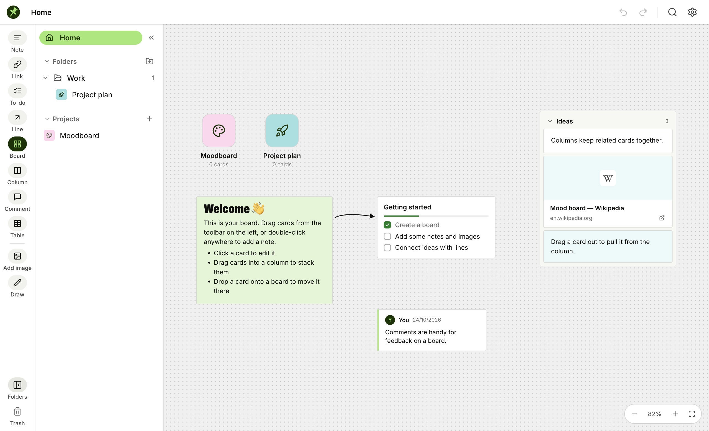

# Pinpad

A visual board app for collecting and arranging ideas: notes, to-dos, links, images, tables,
drawings and nested boards on an infinite canvas, organized into folders. It runs in the
browser, as a native macOS app, and as a Windows app. Everything is stored locally on your
device.



## Download

Get the latest build from the [Releases](../../releases) page:

- **macOS** (Apple silicon and Intel, macOS 13.3+): `Pinpad-<version>-mac.zip`. Unzip and
  move `Pinpad.app` to Applications. The app isn't notarized, so the first time, right-click
  it and choose **Open**.
- **Windows** (10/11): `Pinpad-Setup-<version>-x64.exe` for most PCs,
  `Pinpad-Setup-<version>-arm64.exe` for Windows on ARM. The installer isn't code-signed, so
  SmartScreen will warn; choose **More info → Run anyway**.

## Features

- **Cards:** rich-text notes, to-do lists, links, images, comments, tables and freehand
  drawings; click to edit, drag to move, resize from the right edge
- **Boards inside boards:** double-click a board to open it; drop cards onto a board tile to
  move them in
- **Columns** to stack related cards, and **lines** that connect cards and follow them
- **Folders sidebar** with subfolders; drag projects between folders
- Pan, zoom, marquee select, undo/redo, copy/paste, and search across every board (Ctrl/⌘ K)
- Export and import your whole workspace as JSON
- **Storage folder (desktop apps):** your boards are saved as `Pinpad Workspace.json` in
  Documents/Pinpad, or any folder you choose under ⚙ → Storage location (a synced folder works
  as a backup)

## Development

Requires Node.js 22+.

```bash
npm install
npm run dev          # web app at http://localhost:3000
npm run build        # production web build in dist/
```

### Desktop apps

```bash
npm run build:mac    # build/Pinpad.app (needs Xcode command line tools, run on a Mac)
npm run install:mac  # copy it into /Applications
npm run build:win    # Windows installers in release/ (Electron; can be built on macOS)
npm run desktop      # run the Electron shell locally
```

The macOS app is a small Swift/AppKit wrapper around a WebKit view (`macos/`); the Windows
app uses Electron (`desktop/`). Both load the same web build from inside the app bundle.

## Project layout

```
src/            React + TypeScript web app (Vite)
  components/   canvas, toolbar, sidebar, cards
  store.ts      state, undo history, persistence (IndexedDB, plus the workspace file on desktop)
  native.ts     what the desktop apps expose to the page
macos/          native macOS shell, icon generator, build/install scripts
desktop/        Electron shell and Windows icons
```

## Credits

Pinpad is an independent project inspired by [Milanote](https://milanote.com). Its layout and
visual style follow a design system modeled on [Miro](https://miro.com)'s design language.
Pinpad isn't affiliated with or endorsed by either company.

## License

[MIT](LICENSE)
